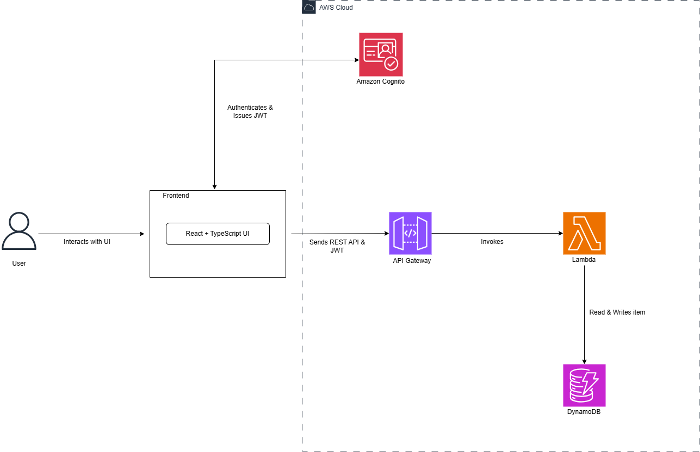

# Habit-tracker
A full-stack goal and daily consistency tracking web application built with a **React + TypeScript** frontend and designed for **AWS serverless backend, authentication, and Infrastructure as Code** integration.

## Solution Architecture
 
## Component 

* **Frontend (`frontend/` — Vite, React, TypeScript):** Renders the user interface (`Login.tsx`, `ProtectedRoute.tsx`, `ConsistencyGrid.tsx`, `MetricCard.tsx`), manages auth state (`AuthContext.tsx`), and calls backend APIs (`services/api.ts`).
* **Amazon Cognito:** Manages user identity, authentication flows, and JSON Web Tokens (JWTs) used to authorize API requests.
* **Amazon API Gateway:** Exposes REST API endpoints over HTTPS and enforces authorization before invoking backend compute.
* **AWS Lambda (`backend/` — Python):** Runs stateless backend logic—such as authentication/post-auth handling, goal CRUD operations, and consistency tracking—without managing servers.
* **Amazon DynamoDB:** NoSQL database storing user goals, habit definitions, and daily consistency logs.
* **Terraform (`terraform/`):** Defines AWS resources (Cognito, API Gateway, Lambda, DynamoDB, IAM roles) declaratively as Infrastructure as Code.
* **GitHub Actions (`.github/workflows/deploy.yml`):** Automates testing, building, and deployment workflows on repository changes.
* **Developer Tooling (`scripts/`, `Makefile`):** Houses helper scripts and common build/development commands.

## Prerequisites

### Phase 1: Frontend Development (Start Here)
* **Node.js & npm:** Required to install packages and run the Vite + TypeScript development server.
* **Git:** Required for version control and repository management.
* **Code Editor (e.g., VS Code):** Recommended for editing TypeScript, React, and Markdown files.

### Phase 2+: Backend, Cloud & Automation (Later Phases)
* **AWS Account & AWS CLI:** Required when deploying Cognito, API Gateway, Lambda, and DynamoDB resources.
* **Python 3.x:** Required for developing and testing AWS Lambda handler functions.
* **Terraform:** Required for provisioning and updating AWS infrastructure as code.
* **GitHub Repository & Secrets:** Required for running GitHub Actions CI/CD pipelines.
